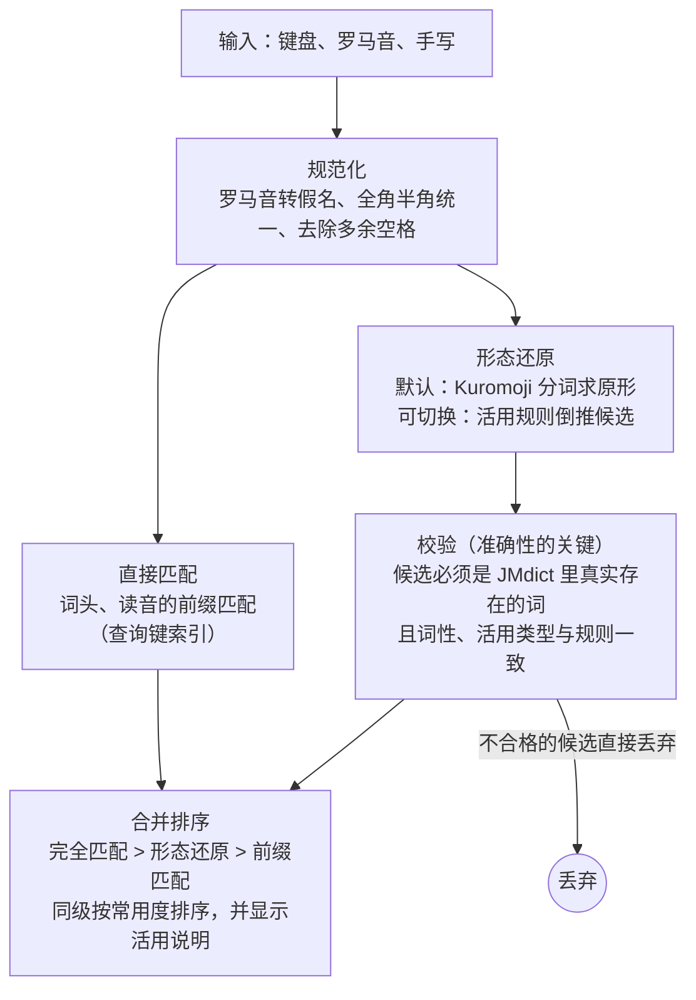

# 日语词典 App 设计明细文档

最后更新：2026-11-20

> 本文件是设计文档的**唯一维护版本**，需求以此为准。编码规范见 [../Architecture.md](../Architecture.md)，AI 协作说明见 [../AGENTS.md](../AGENTS.md)。

## 1. 概述

这是一款只给自己用的 Android 日语词典：查词以离线为主，释义以日本权威国语辞典的日日解释为核心，只保留查词和收藏两大功能。

**为什么要自己做：**

| 现有产品 | 喜欢的地方 | 不满意的地方 |
| --- | --- | --- |
| MOJi辞書 | 收藏功能好用、标注音调 | 强制付费；评论区、社区、AI 等多余功能多；释义来源不透明 |
| Weblio辞書 | 日日释义正宗地道、词汇丰富 | 应用只是网页外壳，必须联网；没有收藏和音调 |

**目标：** 把 Weblio 级别的权威日日释义，放进一个像 MOJi 一样好用、但更简洁、可以离线的软件里。

**已确定的决策：**

**查询方向：** 只做日→日（第一版）和日→中（后续版本）。输入的都是日语（假名、汉字、罗马音、手写），不做中→日反查，也不做日→英。

- 使用范围：只给自己用，安装在自己的荣耀 PPG-AN00（MagicOS 11 / Android 17）上
- 技术：原生 Kotlin + Jetpack Compose；开发时用 scrcpy 在 Mac 上实时查看手机画面
- 释义语言：第一版只做日日释义；日→中释义等日日释义和软件功能稳定后再做
- 辞书：デジタル大辞泉（主）+ 明鏡国語辞典 第三版（辅）+ 新明解国語辞典 第八版（第二辅助，可停用）+ NHK 日本語発音アクセント新辞典 2016（音调）
- 体积：只用辞书的文字部分，不用图片和音频；词库不打包进安装包，首次启动时从手机存储导入
- 分词：内置 Kuromoji + IPADIC（默认）和活用规则两种方式，可在设置中切换；Sudachi 以后按需加入
- 音调：只显示数字（⓪①②…）
- 收藏：多个收藏夹 + 导出与备份
- 查词方式：文字输入、形态还原、手写；不做拍照识别、其他应用划词查询、发音朗读

## 2. 功能范围

第一版只做查词和收藏，其他功能一律不做。

| 模块 | 要做 | 优先级 |
| --- | --- | --- |
| 查词 | 假名、汉字、罗马音输入；输入时实时候选；形态还原 | P0 |
| 手写输入 | 在手写板上写不会读的汉字，识别后查词 | P0 |
| 词条页 | 大辞泉、明鏡、新明解释义；音调数字；例句；网页页签 | P0 |
| 辞书管理 | 导入辞书数据包（.db）；排序、启用、停用 | P0 |
| 分词器设置 | 在 Kuromoji 和活用规则之间切换 | P0 |
| 收藏 | 多个收藏夹；一个词可以放进多个收藏夹 | P0 |
| 导出与备份 | 导出 CSV / Anki；整库备份和恢复 | P1 |
| 查词历史 | 最近查过的词，可清空 | P1 |
| 日汉中文释义 | 导入小学館日中辞典，显示一行中文意思（日→中） | 后续版本 |
| 显示注音开关 | 释义里的汉字上方显示假名注音（ruby），设置中一键开关；明鏡数据自带，其他辞书按需补 | 后续版本 |

**明确不做：** 评论区、社区、问答、文章阅读、翻译、AI 问答、拍照识别、其他应用划词查询、发音朗读、背词复习、个人笔记、登录和账号、付费、广告。

## 3. 词库与辞书组合

第一版辞书组合定为 **デジタル大辞泉（主）+ 明鏡国語辞典 第三版（辅）+ 新明解国語辞典 第八版（第二辅助）+ NHK アクセント新辞典 2016（音调）**，只用文字部分，词库合计实测约 100 MB。两部辅助辞典各是一个独立数据包，不想要哪部就不导入或在设置中停用。软件本身是“辞书阅读引擎”：用 JMdict 做统一词头索引，其上叠加导入的辞书。

### 3.1 分层结构

| 层 | 作用 | 第一版来源 | 离线 |
| --- | --- | --- | --- |
| 骨架索引 | 词头、读音、词性、活用类型、常用度；负责搜索和形态还原校验 | JMdict | 是 |
| 主国语辞典 | 核心日日释义 | デジタル大辞泉 | 是 |
| 辅助国语辞典 | 用法说明、误用辨析（「問題なことば」） | 明鏡国語辞典 第三版 | 是 |
| 第二辅助辞典 | 精炼而有个性的释义、自带音调数字 | 新明解国語辞典 第八版（可停用） | 是 |
| 音调 | 显示 ⓪①② 数字 | NHK アクセント新辞典 2016 → 新明解第八版 → Kanjium，依次兜底 | 是 |
| 例句 | 真实用例 | 辞典自带例句 | 是 |
| 网页页签 | 补充、对照、新词 | コトバンク、Weblio | 否 |
| 中文释义 | 一行中文意思（日→中） | 小学館日中辞典（tyuka 版） | 后续版本 |

### 3.2 辞书清单与检查结果

| 辞书 | 出版社 | 文件检查结果 | 第一版 |
| --- | --- | --- | --- |
| デジタル大辞泉（2020 年版） | 小学館 | 约 30 万词条；词头格式「たべる【食べる】」自带读音，可与 JMdict 准确对齐 | ✅ 主辞典 |
| 明鏡国語辞典 第三版（2021） | 大修館 | MDX，UTF-8 未加密；约 6.8 万正文词条（其余约 33.5 万条是 `@@@LINK=` 跳转）；词头「た・べる【食べる】」；汉字几乎都带 `<ruby>` 注音，需要清理；**正文不含音调数字** | ✅ 辅助辞典 |
| 新明解国語辞典 第八版（2020） | 三省堂 | Yomitan 格式；100,593 条记录；词头和读音分开存放，带活用类型（如 `v1`）和音调数字（如 ②）；外字是 SVG | ✅ 第二辅助辞典 |
| NHK 日本語発音アクセント新辞典（2016） | NHK出版 | JSON；本质是**录音索引**：23.2 万个检索词 → 10.3 万条录音，每条录音带片假名读音、音调数字（含复合词「1+1」写法）和下降位置；音频本身不在文件里 | ✅ 音调 |
| 大辞林 第四版（2019） | 三省堂 | Yomitan 格式；约 33.5 万条记录；解压后 JSON 约 2.7 GB，处理后体积待实测 | 后续版本（第二主辞典） |
| 小学館 日中辞典（tyuka 版） | 小学館 | 约 14 万索引；可用汉字和罗马音查询，格式干净 | 后续版本（中文释义） |
| 小学館 V2 日汉辞典 | 小学館 | 只能用假名查询 | 不用（tyuka 版更好） |
| 新明解 第七版、大辞林 第三版、NHK 1998 年版 | — | 已被新版取代，留作对照 | 不用 |

**NHK 2016 实测注意点（2026-11-19 抽查）：** 「食べる」「読む」等动词带有各活用形的录音（タベナイ②、タベマス③…），音调数字确实可以直接读出；但它不是完整的辞典，转换时要处理三类问题：
1. **同一检索词混着多个词和带助词的录音**：如「端」下面有 タン、ハシ、ハタ、ハシオ（＝端を）等，必须按「词头 + 读音」和 JMdict 对齐，只取原形的录音。
2. **有遗漏和错配**：如「昨日」只有サクジツ、没有キノウ；「飴」只对应到「のど飴」。这些情况交给新明解第八版和 Kanjium 兜底。
3. **复合音调**：「1+1」这类写法原样保存并显示。

### 3.3 辞书文件与格式

- 电脑端转换脚本（Python）支持三种输入：**MDict（.mdx）**、**Yomitan（.zip）**、**NHK 2016（.json）**。每种格式一个读取器，输出统一的中间结构，再生成 SQLite 数据包并和 JMdict 词头对齐。EPWING 不做。
- 手机端只认最终生成的 `.db` 数据包，不在手机上解析任何原始格式；以后换了辞书来源，手机端代码不用改。
- 释义正文统一转成精简 HTML（只留粗体、上下标、注音、链接等少数标签），去掉原辞书的 CSS 和 `<head>`。明鏡自带的逐字注音保留在数据包里，第一版显示时隐藏；以后做「显示注音」开关时直接用，不用重新转换。
- 不使用 .mdd 多媒体包和任何音频；外字（大辞泉的小图片、明鏡和新明解的 SVG）单独提取，能换成 Unicode 字符的就换掉。
- 词库数据包不打进安装包：用 adb 推到手机存储，首次启动时导入一次。重新安装 App 不用重新导入。
- 这些辞书文件仅供个人使用，软件和数据包不对外分发。

### 3.4 体积预算

实测方法：去掉多余 HTML 后，按词条单独用 zstd 压缩（带训练字典），查词时只解压单条。

**M0 实测（2026-11-19）：**

| 数据包 | 内容 | 词条数 | 大小 |
| --- | --- | --- | --- |
| `core.db` | JMdict 骨架（21.9 万词条、32.6 万种写法、47 万查询键）+ 音调 11.4 万条 | — | 31.9 MB |
| `dict_daijisen.db` | 大辞泉正文 | 297,155 | 46.5 MB |
| `dict_meikyo3.db` | 明鏡正文（保留注音） | 68,075 | 12.3 MB |
| `dict_shinmeikai8.db` | 新明解正文 | 77,125 | 9.4 MB |
| **词库合计** | | | **100.1 MB**（gzip 后约 67 MB） |
| App 本体（含 Kuromoji IPADIC） | | | 约 25 MB（M1 实测） |
| 后续：小学館日中 / 大辞林 第四版 | | | 待实测 |

比原先估的 75–90 MB 多了约 10 MB，主要是两处：
- `core.db`：为了离线查询和形态还原校验，JMdict 的全部写法和查询键都要存。
- 大辞泉：30 万条里约一半是百科、人名地名，正文本身就大。

**词库上限因此调整为 ≤ 110 MB。** 明鏡的注音实测只占 1.7 MB，所以保留。如果想再省空间，有两个办法：
- 停用新明解，省 9 MB。
- 不导入大辞泉的百科类条目，约省 15–20 MB；但人名、地名就查不到了。

**压缩方式：** 每条正文单独用 zstd 压缩，配一个从本辞书训练出来的 1 MB 字典。实测 1 MB 字典比 128 KB 小 16%，单条解压只要几微秒。

对比：手机上的 MOJi 是 280 MB 本体加 119 MB 数据。

### 3.5 网页页签

- コトバンク：可看精選版日本国語大辞典等更多辞书。
- Weblio：可看大辞林、実用日本語表現辞典、新词和俗语。
- 两个站点互为备份。只在用户点开页签时才加载，原样显示网页。

## 4. 查词设计

形态还原默认用 Kuromoji 分词器，可在设置中切换为活用规则；不论哪种方式，结果都必须通过 JMdict 校验，只有真实存在、活用类型一致的原形才会出现在结果里。

直接匹配和形态还原并行进行，形态还原得到的候选必须先通过校验，最后两路结果合并排序。

### 4.1 搜索

- 支持假名、汉字、罗马音输入；罗马音实时转换成假名再查
- 输入时实时显示候选，每个候选显示词头、读音和音调数字
- **候选排序**：完全匹配优先；假名输入时，常用且主读音就是输入的「通常写假名」词（する→為る）排前；其余按排序分。排序分由 JMdict 常用度和新明解第八版的基本词标记（＊＊ 最基本、＊ 基本）合成，因为 JMdict 常用度太粗（很多基本动词并列，「かく」会让「核」排在「書く」前面）。
- 「通常写假名」取 JMdict 第一个义项的 `uk` 标记，比「任意义项」好：排序测试集上 117/117 对 116/117（后者把「易い」排到「安い」前面）。
- **候选显示规则：同一个结果列表里，任何两行看起来都不能一样。**
  - 「通常写假名」的词，在输入的是它的主读音时显示假名词头，并在旁边附上汉字写法（なる 成る・為る）；不是主读音时显示汉字（はし → 嘴）。
  - JMdict 里同写法、同读音的多个条目（腰／こし 有两条）：如果它们指向的辞书释义完全一样，合并成一行；否则在下面加一行释义开头作提示，优先取只属于这一行的释义。
  - 测试覆盖全部 3047 个常用同音读音，目前没有无法区分的行。
- **只收录在单本辞书里的词**（地名、人名、百科条目、部分惯用句，JMdict 里没有）：JMdict 结果少于 20 个时，从各辞书的 `dict_key` 表各补最多 10 个，排在 JMdict 结果后面，前面加一条浅灰底的分组小标题「只收录在单本辞书里的词条」。这类词没有主词条，点进去只显示那一本辞书的释义，也没有音调。词条名按辞书原标题显示，不统一成「汉字 + 读音」格式（用户决定）。
- **搜索速度**：每个查询键的排序值在生成 core.db 时预先算好（`search_key.rank`），搜索只需扫一张表，不用联表和分组。单个假名（会匹配上万个词）也很快：真机 p95 从 58.6 ms 降到 9.3 ms。
- 输入的是一整句时，用 Kuromoji 分词，句中每个词都可以点击单独查询
- 查询方向只有日→日（第一版）和日→中（后续版本）；不做中→日反查，也不做日→英

### 4.2 分词器与形态还原

三种方案都纳入设计，第一版实现 A 和 B，默认 A；C 后期按需加入。

| 方案 | 设备上体积 | 特点 | 第一版 |
| --- | --- | --- | --- |
| A. Kuromoji + IPADIC | 约 32 MB（jar 压缩后 13 MB） | 能切分整句；词典是 2007 年的，项目基本停止维护；歧义词只给一个答案 | ✅ 默认 |
| B. 活用规则 + JMdict 校验 | 约 0.1 MB | 歧义词列出全部合法原形；不能切整句；规则要自己维护 | ✅ 设置中可切换 |
| C. Sudachi + small / core 词典 | 110 MB / 193 MB | 维护活跃（词典 2026-10 更新）；能统一不同写法（シュミレーション→シミュレーション）；体积大 | 后期按需 |

**实测结果（2026-11-19，22 个难点词）：** 三种分词器对单个词的原形还原结果几乎一致；差别在歧义词上：「いった」→ Sudachi 给「いく」、IPADIC 给「いう」；「読めない」→ 都给「読める」而不是「読む」。

**设计要点：**

1. **统一接口**：定义一个「还原器」接口，A、B、C 都是它的实现；以后加 Sudachi 只需新增一个实现，其他代码不动。
2. **统一校验**：任何方案给出的原形，都必须在 JMdict 里存在且词性、活用类型一致，否则丢弃。
3. **A 模式下的补救**：Kuromoji 的结果校验不通过、或结果是可能动词（如「読める」）时，自动调用 B 补充候选（如「読む」）。
4. **B 的维护方式**：规则写成一份数据表（词尾变化 + 适用活用类型），不写死在代码里；新增边界情况只需添一行规则和一条测试用例。
5. **歧义全部列出**：B 模式下「いった」显示「行く・言う・要る」，按常用度排序并标出活用说明。
6. **重点覆盖的难点**：する・来る、音便、可能形与被动形重合、敬语、复合活用、口语缩约（食べちゃった・行かなきゃ）。
7. **测试集**：至少 500 条「活用形 → 正确原形」用例，A、B 两种模式都要跑并分别统计准确率；每次修改都要全部跑通才能发布。

### 4.3 手写输入

- 使用 Google ML Kit Digital Ink Recognition 的日语模型；首次使用时下载模型（约 20 MB），之后完全离线
- 支持一次写多个字；上方显示 8 个候选字，点选后追加到搜索框
- 提供撤销一笔、清空两个按钮
- 不做拍照识别

## 5. 页面与交互

底部只有三个入口：查词、收藏、设置。

| 页面 | 内容 |
| --- | --- |
| 查词首页 | 顶部搜索框（右侧手写按钮）；输入时实时显示候选；空白时显示查词历史 |
| 手写面板 | 从底部弹出的手写板，上方一排候选字，点选后填入搜索框 |
| 词条页 | 见下方布局 |
| 收藏夹列表 | 所有收藏夹及词数；新建、重命名、删除、排序 |
| 收藏夹详情 | 词列表（词头、读音、音调数字、主辞典释义第一句）；按加入时间或五十音排序；批量移动、删除、导出 |
| 设置 | 辞书管理（导入、排序、启用）、分词器（Kuromoji / 活用规则）、备份与恢复、字号、深色模式 |

**词条页布局（从上到下）：**

1. 词头区：词头（大字）、读音、音调数字（如「⓪」「③」，多个读法并列）、词性、常用度标记；右上角是收藏按钮（☆/★）
2. 形态还原提示：从活用形查到时显示「食べなかった ← 食べる（否定・過去）」
3. 辞书释义：大辞泉默认展开，明鏡和新明解默认折叠；顺序可在设置中调整
4. 例句
5. 页签栏：「离线」「コトバンク」「Weblio」，切换时不离开词条页

**交互细节：**

- 点击释义里的任意词，可以直接跳转查该词（形态还原同样生效）
- 长按收藏按钮，弹出收藏夹多选列表；单击则加入默认收藏夹
- 支持深色模式和字号调节

**视觉风格：** 内容优先、克制留白；Material 3，中性色加一种强调色（可切换为动态取色），浅色和深色两套主题；日文统一使用系统自带的 Noto Sans CJK JP 字形，并按词组断行；详细规范见 Architecture.md 第 6 节。

## 6. 收藏、导出与备份

收藏是多对多关系：一个词可以属于多个收藏夹；收藏记录保存词头和读音，辞书换了也不会丢。

**收藏夹**

- 自带一个「默认」收藏夹，不可删除
- 可新建、重命名、删除、拖动排序；删除收藏夹时只移除关系，不影响该词在其他收藏夹里的记录
- 收藏时自动记录时间，作为排序依据

**导出**

| 格式 | 内容 | 用途 |
| --- | --- | --- |
| CSV | 词头、读音、音调数字、主辞典释义第一句、收藏夹、收藏时间 | 用 Excel 或其他软件查看 |
| Anki（.apkg） | 正面词头，背面读音、音调、主辞典第一条释义 | 导入 Anki 复习 |

可以导出全部或选定的收藏夹，文件通过 Android 系统分享面板保存或发送。

**备份与恢复**

- 备份文件是一个 .zip，包含收藏夹、收藏记录、查词历史、设置；不包含辞书文件本身
- 手动备份：保存到手机任意位置或云盘
- 自动备份：每周自动备份到用户选定的文件夹，保留最近 5 份
- 恢复前先自动备份当前数据，防止误操作

## 7. 技术架构与数据设计

全部数据存在本机 SQLite 里，辞书内容和用户数据分开存放，没有任何服务器。

**技术选型**

| 领域 | 选用 |
| --- | --- |
| 语言 / 界面 | Kotlin + Jetpack Compose，Material 3 |
| 数据库 | 数据包为只读 SQLite（不经 Room）；收藏等用户数据用 Room（M4）。查询用规范化查询键的 B 树索引做前缀匹配（不依赖 FTS5，Android 自带的 SQLite 不保证有）；释义正文按条 zstd 压缩 |
| 分词与形态还原 | Kuromoji + IPADIC（默认）、活用规则表（可切换）；Sudachi 后期按需 |
| 手写识别 | Google ML Kit Digital Ink Recognition（日语模型，首次使用时下载，之后离线） |
| 网页页签 | Android WebView |
| 辞书转换 | 电脑端 Python 脚本：.mdx / Yomitan .zip / NHK .json → SQLite 数据包，并与 JMdict 对齐 |
| 开发与预览 | Gradle 命令行构建，adb 安装，scrcpy 投屏查看 |
| 最低系统 | Android 10（API 29）；targetSdk 跟随最新 |

**数据库拆分**

- `core.db`：JMdict 骨架、音调数字（NHK 2016、新明解第八版、Kanjium）；作为数据包导入，可整体更新
- `dict_<id>.db`：每部辞书一个文件（第一版：大辞泉、明鏡、新明解），删除辞书就是删除文件
- `user.db`：收藏、历史、设置，是唯一需要备份的文件
- 数据包存放在 App 私有目录；安装包里不含任何词库

**主要数据表**

| 表 | 所在文件 | 主要字段 |
| --- | --- | --- |
| entry | core.db | id（JMdict 序号）、词性和活用类型代码（如 `v1,vt`）、常用度、标记（通常写假名）、排序分（常用度结合新明解的「＊＊/＊」基本词标记） |
| form | core.db | entry id、序号（0 为显示用词头）、汉字写法、读音、常用度 |
| search_key | core.db | 查询键（规范化后的写法或读音）、entry id、常用度 |
| pitch | core.db | entry id、读音、音调数字、来源（nhk2016 / smk8 / kanjium） |
| dict_entry | dict_&lt;id&gt;.db | id、压缩后的「标题 + 正文」 |
| dict_link | dict_&lt;id&gt;.db | 辞书词条 id ↔ JMdict entry id（多对多） |
| dict_key | dict_&lt;id&gt;.db | 只存 core.db 查不到的查询键（百科条目、惯用句等） |
| zdict | dict_&lt;id&gt;.db | zstd 训练字典 |
| dictionary | user.db | id、名称、类型（国语 / 音调）、优先级、是否启用 |
| folder | user.db | id、名称、排序、创建时间 |
| favorite | user.db | 词头、读音、收藏夹 id、收藏时间 |
| history | user.db | 词头、读音、查询时间 |

**性能目标**

- 输入后候选列表出现 ≤ 50 ms
- 点击候选到词条页完整显示（离线部分）≤ 150 ms
- 冷启动到可输入 ≤ 800 ms；Kuromoji 在后台加载，不阻塞输入
- 安装包 ≤ 30 MB；词库数据包合计 ≤ 110 MB

## 8. 开发里程碑与待定事项

先做数据准备，再分四个阶段开发，每个阶段结束都能在手机上实际使用（用 scrcpy 验收）。

| 阶段 | 内容 | 验收标准 |
| --- | --- | --- |
| M0 数据准备 | 下载 JMdict、Kanjium；编写 MDX、Yomitan、NHK JSON 三个读取器；生成 core.db 和大辞泉、明鏡、新明解数据包 | ✅ 2026-11-19 完成：数据包合计 100.1 MB；50 个音调抽查全部正确，NHK 与 Kanjium 在 2.6 万常用词上一致率 99.2%；常用词覆盖率：大辞泉 94.8%、明鏡 86.5%、新明解 87.1%，三部合计 95.8% |
| M1 能查词 | 工程搭建；数据包导入；搜索、词条页、音调数字 | 离线查任意常用词，候选 ≤ 50 ms。实测（真机，2026-11-19）：候选 p95 9.3 ms，词条 p95 3.4 ms，冷启动约 450 ms，release APK 3.0 MB；✅ 2026-11-20 用户验收通过 |
| M2 查得准 | Kuromoji 和活用规则两种还原器 + JMdict 校验 + 设置切换；手写输入；形态还原测试集 | 测试集在默认模式下全部通过 |
| M3 释义完善 | 辞书管理（排序、启用）；释义排版和外字；网页页签 | 三部辞书按优先级正确显示，排版和外字无乱码 |
| M4 收藏完善 | 收藏夹、导出 CSV / Anki、备份与恢复、查词历史 | 备份后卸载重装能完整恢复 |
| 后续版本 | 日→中释义；大辞林第四版；Sudachi 还原器；显示注音开关 | 日日释义和功能稳定后再定 |

**待定事项**

- [x] 主辞典是否同时使用大辞泉和大辞林 —— 第一版只用大辞泉；大辞林放到后续版本。
- [x] 辅助辞典用哪部 —— 明鏡第三版作辅助、新明解第八版作第二辅助（可停用）；新明解第七版只留作对照。
- [x] 中文释义的来源 —— 第一版不做；日日释义和功能稳定后，用小学館日中辞典（tyuka 版）实现。
- [x] 是否需要「其他应用划词查询」 —— 不做。
- [x] 是否需要发音朗读 —— 不做。
- [x] 应用名称和图标 —— 暂用占位名称「辞書」和简单文字图标，以后再定。
- [x] 分词器方案 —— 第一版实现 Kuromoji（默认）和活用规则，设置中可切换；Sudachi 后期按需。
- [x] 是否另找真正的明鏡国語辞典 —— 已找到第三版（2021）并核对过内容，加入第一版。
- [x] 音调来源 —— 改用 NHK 2016 JSON，不再解析 1998 年版的图片编码；NHK 缺的词由新明解第八版和 Kanjium 兜底。
- [x] 转换脚本支持哪些输入格式 —— MDict、Yomitan、NHK JSON 三种；手机端只认 .db。
