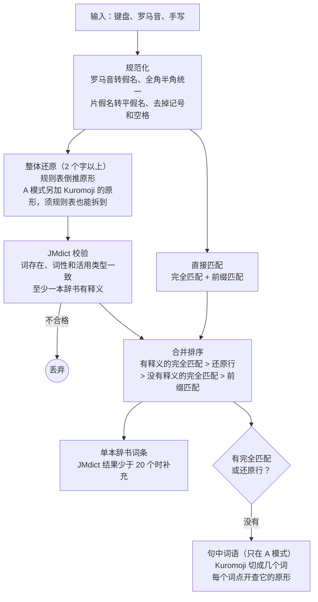

# 日语词典 App 设计明细文档

最后更新：2026-11-21

> 本文件是设计文档的**唯一维护版本**，需求以此为准。编码规范见 [../Architecture.md](../Architecture.md)，AI 协作说明见 [../AGENTS.md](../AGENTS.md)。

## 1. 概述

这是一款只给自己用的 Android 日语词典：查词以离线为主，释义以日本权威国语辞典的日日解释为核心，只保留查词和收藏两大功能。

**为什么要自己做：**

| 现有产品 | 喜欢的地方 | 不满意的地方 |
| --- | --- | --- |
| MOJi辞書 | 收藏功能好用、标注音调 | 强制付费；评论区、社区、AI 等多余功能多；释义来源不透明 |
| Weblio辞書 | 日日释义正宗地道、词汇丰富 | 应用只是网页外壳，必须联网；没有收藏和音调 |

**目标：** 把 Weblio 级别的权威日日释义，放进一个像 MOJi 一样好用、但更简洁、可以离线的软件里。

**已确定的决策：**

**查询方向：** 只做日→日（第一版）和日→中（M5）。输入的都是日语（假名、汉字、罗马音、手写），不做中→日反查，也不做日→英。

- 使用范围：只给自己用，安装在自己的荣耀 PPG-AN00（MagicOS 11 / Android 17）上
- 技术：原生 Kotlin + Jetpack Compose；开发时用 scrcpy 在 Mac 上实时查看手机画面
- 释义语言：第一版只做日日释义；日→中释义等日日释义和软件功能稳定后再做
- 辞书：デジタル大辞泉（主）+ 明鏡国語辞典 第三版（辅）+ 新明解国語辞典 第八版（第二辅助，可停用）+ NHK 日本語発音アクセント新辞典 2016（音调）
- 体积：只用辞书的文字部分，不用图片和音频；词库不打包进安装包，首次启动时从手机存储导入
- 分词：内置 Kuromoji + IPADIC（默认）和活用规则两种方式，可在设置中切换（Sudachi 已放弃，2026-11-21）
- 音调：只显示数字（⓪①②…）
- 收藏：多个收藏夹 + 导出与备份
- 查词方式：文字输入、形态还原、手写；不做拍照识别、其他应用划词查询、发音朗读

## 2. 功能范围

第一版只做查词和收藏，其他功能一律不做。

| 模块 | 要做 | 优先级 |
| --- | --- | --- |
| 查词 | 假名、汉字、罗马音输入；输入时实时候选；形态还原 | P0 |
| 手写输入 | 在手写板上写不会读的汉字，识别后查词 | P0 |
| 词条页 | 大辞泉、明鏡、新明解释义；音调数字；例句；网页页签 | P0 |
| 辞书管理 | 导入辞书数据包（.db）；排序、启用、停用 | P0 |
| 分词器设置 | 在 Kuromoji 和活用规则之间切换 | P0 |
| 收藏 | 多个收藏夹；一个词可以放进多个收藏夹 | P0 |
| 导出与备份 | 导出 CSV / Anki、从 CSV 导入；整库备份和恢复 | P1 |
| 查词历史 | 最近查过的词，可清空 | P1 |
| 日汉中文释义 | 导入小学館日中辞典 第三版（主）和新世纪日汉双解大辞典，显示一行中文意思和完整中文释义（日→中） | M5 |
| ~~显示注音开关~~ | 释义里的汉字上方显示假名注音（ruby）。2026-11-21 决定放弃：没有对所有辞书都优雅的做法（只有明鏡自带注音） | 放弃 |

**明确不做：** 评论区、社区、问答、文章阅读、翻译、AI 问答、拍照识别、其他应用划词查询、发音朗读、背词复习、个人笔记、登录和账号、付费、广告。

## 3. 词库与辞书组合

第一版辞书组合定为 **デジタル大辞泉（主）+ 明鏡国語辞典 第三版（辅）+ 新明解国語辞典 第八版（第二辅助）+ NHK アクセント新辞典 2016（音调）**，只用文字部分，词库合计实测约 100 MB。两部辅助辞典各是一个独立数据包，不想要哪部就不导入或在设置中停用。软件本身是“辞书阅读引擎”：用 JMdict 做统一词头索引，其上叠加导入的辞书。

### 3.1 分层结构

| 层 | 作用 | 第一版来源 | 离线 |
| --- | --- | --- | --- |
| 骨架索引 | 词头、读音、词性、活用类型、常用度；负责搜索和形态还原校验 | JMdict | 是 |
| 主国语辞典 | 核心日日释义 | デジタル大辞泉 | 是 |
| 第二主国语辞典 | 另一套独立编写的大型日日释义 | 大辞林 第四版 | 是（M5） |
| 辅助国语辞典 | 用法说明、误用辨析（「問題なことば」） | 明鏡国語辞典 第三版 | 是 |
| 第二辅助辞典 | 精炼而有个性的释义、自带音调数字 | 新明解国語辞典 第八版（可停用） | 是 |
| 音调 | 显示 ⓪①② 数字 | NHK アクセント新辞典 2016 → 新明解第八版 → Kanjium，依次兜底 | 是 |
| 例句 | 真实用例 | 辞典自带例句 | 是 |
| 网页页签 | 补充、对照、新词 | コトバンク、Weblio | 否 |
| 中文释义 | 一行中文意思、完整日中释义、日汉双解 | 小学館日中辞典 第三版（主）、新世纪日汉双解大辞典 | 是（M5） |

### 3.2 辞书清单与检查结果

| 辞书 | 出版社 | 文件检查结果 | 第一版 |
| --- | --- | --- | --- |
| デジタル大辞泉（2020 年版） | 小学館 | 约 30 万词条；词头格式「たべる【食べる】」自带读音，可与 JMdict 准确对齐 | ✅ 主辞典 |
| 明鏡国語辞典 第三版（2021） | 大修館 | MDX，UTF-8 未加密；约 6.8 万正文词条（其余约 33.5 万条是 `@@@LINK=` 跳转）；词头「た・べる【食べる】」；汉字几乎都带 `<ruby>` 注音，需要清理；**正文不含音调数字** | ✅ 辅助辞典 |
| 新明解国語辞典 第八版（2020） | 三省堂 | Yomitan 格式；100,593 条记录；词头和读音分开存放，带活用类型（如 `v1`）和音调数字（如 ②）；外字是 SVG | ✅ 第二辅助辞典 |
| NHK 日本語発音アクセント新辞典（2016） | NHK出版 | JSON；本质是**录音索引**：23.2 万个检索词 → 10.3 万条录音，每条录音带片假名读音、音调数字（含复合词「1+1」写法）和下降位置；音频本身不在文件里 | ✅ 音调 |
| 大辞林 第四版（2019） | 三省堂 | Yomitan 格式；约 33.5 万条记录，合并后 26.9 万正文词条；解压后 JSON 约 2.7 GB；预计数据包 32–35 MB，常用词覆盖 95.9%（2026-11-21 估算） | M5 ①（第二主辞典） |
| 小学館 日中辞典 第三版（2015/16） | 小学館 | MDX（Kotobank 源）；9.4 万正文、5.2 万跳转；HTML 结构清楚（义项、〔用法〕、译词、例句和译文）；预计 12 MB，常用词覆盖 91.1% | M5 ②（日中主辞典） |
| 新世纪日汉双解大辞典 | 外研社（三省堂底本） | MDX；15.4 万正文、24.7 万跳转；每个义项先日文释义再中文翻译；原文样式标签占 87%；预计 28–31 MB，常用词覆盖 88.5% | M5 ③（日汉双解，可停用） |
| 讲谈社 日汉大辞典、现代日汉双解词典 | — | 讲谈社混有英文、数据由电子辞书提取合并，质量待核实；现代日汉常用词覆盖仅 71.9%、为「AI 校对文字版」 | 暂不做 |
| 小学館 日中辞典 tyuka 版 / V2 版 | 小学館 | 已被第三版取代（tyuka 版覆盖 83.5%，第三版 91.1%） | 不用 |
| 新明解 第七版、大辞林 第三版、NHK 1998 年版 | — | 已被新版取代，留作对照 | 不用 |

**NHK 2016 实测注意点（2026-11-19 抽查）：** 「食べる」「読む」等动词带有各活用形的录音（タベナイ②、タベマス③…），音调数字确实可以直接读出；但它不是完整的辞典，转换时要处理三类问题：
1. **同一检索词混着多个词和带助词的录音**：如「端」下面有 タン、ハシ、ハタ、ハシオ（＝端を）等，必须按「词头 + 读音」和 JMdict 对齐，只取原形的录音。
2. **有遗漏和错配**：如「昨日」只有サクジツ、没有キノウ；「飴」只对应到「のど飴」。这些情况交给新明解第八版和 Kanjium 兜底。
3. **复合音调**：「1+1」这类写法原样保存并显示。

### 3.3 辞书文件与格式

- 电脑端转换脚本（Python）支持三种输入：**MDict（.mdx）**、**Yomitan（.zip）**、**NHK 2016（.json）**。每种格式一个读取器，输出统一的中间结构，再生成 SQLite 数据包并和 JMdict 词头对齐。EPWING 不做。
- 手机端只认最终生成的 `.db` 数据包，不在手机上解析任何原始格式；以后换了辞书来源，手机端代码不用改。
- 释义正文统一转成精简 HTML（只留粗体、上下标、注音、链接等少数标签），去掉原辞书的 CSS 和 `<head>`。明鏡自带的逐字注音保留在数据包里，第一版显示时隐藏；（「显示注音」开关已放弃，数据保留不影响使用。）
- 不使用 .mdd 多媒体包里的插图和任何音频。**外字**（标准字符集里没有、辞书画成小图片的字和记号）单独处理（M3 实测）：
  - 三部辞书合计约 330 种外字图片（大辞泉 75、明鏡 116、新明解 142）。出现次数绝大多数是记号：分段编号（黑底、白底方框里的「一」「二」）、圆圈数字、「参考」「対義語」这类标签图标。
  - **编号由 App 自己画**：三部辞书的黑底方框、白底方框分段编号（一、二…），以及明鏡的实心圆圈义项编号（原书 1～20 是文字 ❶～⓴，21～56 是图片），统一画成主题色的方框和圆圈，最多可到 99。黑底方框 = 实心，白底方框 = 同样大小的空心，便于对照；浅色、深色主题都会自动换色。数字和汉字都在图形里视觉居中（2026-11-20 用户选定「B 主题色」方案）。
  - 明鏡里的白底圆圈 ①～⑳ 是「参见第几义」的引用，原书有意和 ❶ 区分，保留文字；新明解的 ①～⑬ 是音调数字，也不动。
  - 其余能用文字准确表达的换成文字：¢、ü、ň、√2、分数、新明解带标题的生僻字（抛、簒…）等。替换表逐条写明理由（`tools/dicts/gaiji/`）。
  - 其余（生僻字异体、乐谱记号、明鏡「問題なことば」图标等）保留原图，存进辞书包，在正文里按一个字的大小显示：大辞泉 51 种、明鏡 35 种、新明解 53 种，合计约 90 KB。
  - 原辞书自带的替代文字不可靠（明鏡的分段编号都写成「3分の2」，生僻字写成「〓」），不能直接用。
- 词库数据包不打进安装包：用 adb 推到手机存储，首次启动时导入一次。重新安装 App 不用重新导入。
- 这些辞书文件仅供个人使用，软件和数据包不对外分发。

### 3.4 体积预算

实测方法：去掉多余 HTML 后，按词条单独用 zstd 压缩（带训练字典），查词时只解压单条。

**M0 实测（2026-11-19）：**

| 数据包 | 内容 | 词条数 | 大小 |
| --- | --- | --- | --- |
| `core.db` | JMdict 骨架（21.9 万词条、32.6 万种写法、47 万查询键）+ 音调 11.4 万条 | — | 31.9 MB |
| `dict_daijisen.db` | 大辞泉正文（M3 加外字图片 5 KB） | 297,155 | 46.5 MB |
| `dict_meikyo3.db` | 明鏡正文（保留注音；M3 加外字图片 32 KB） | 68,075 | 12.4 MB |
| `dict_shinmeikai8.db` | 新明解正文（M3 加外字图片 52 KB） | 77,125 | 9.5 MB |
| `dict_daijirin4.db` | 大辞林第四版正文（M5，2026-11-21；外字图片 45 KB） | 269,105 | 35.6 MB |
| `dict_shogakukan_jc3.db` | 小学館日中辞典第三版（M5，2026-11-21；外字图片 25 KB，插图不收） | 96,489 | 12.3 MB |
| `dict_shinseiki_jc.db` | 新世纪日汉双解大辞典（M5，2026-11-21；插图不收） | 179,866 | 30.4 MB |
| **词库合计** | | | **100.4 MB**（M3；M0 时 100.1 MB，gzip 后约 67 MB） |
| App 本体（含 Kuromoji IPADIC） | | | 约 25 MB（M1 实测） |
| **M5 后词库合计** | | | **178.8 MB**（上限 200 MB；明细见 [dictionaries.md](dictionaries.md)） |

比原先估的 75–90 MB 多了约 10 MB，主要是两处：
- `core.db`：为了离线查询和形态还原校验，JMdict 的全部写法和查询键都要存。
- 大辞泉：30 万条里约一半是百科、人名地名，正文本身就大。

**词库上限因此调整为 ≤ 110 MB。**（2026-11-21 用户决定再放宽到 **≤ 200 MB**，给 M5 的三部辞书留空间，预计加入后合计约 175 MB。） 明鏡的注音实测只占 1.7 MB，所以保留。如果想再省空间，有两个办法：
- 停用新明解，省 9 MB。
- 不导入大辞泉的百科类条目，约省 15–20 MB；但人名、地名就查不到了。

**压缩方式：** 每条正文单独用 zstd 压缩，配一个从本辞书训练出来的 1 MB 字典。实测 1 MB 字典比 128 KB 小 16%，单条解压只要几微秒。

对比：手机上的 MOJi 是 280 MB 本体加 119 MB 数据。

### 3.5 网页页签

- コトバンク：可看精選版日本国語大辞典等更多辞书。打开站内搜索页（`kotobank.jp/search?q=词`），因为词条网址带编号，无法直接拼出。
- Weblio：可看大辞林、実用日本語表現辞典、新词和俗语。打开 `weblio.jp/content/词`。
- 两个站点互为备份。页签在词条页顶部（离线 | コトバンク | Weblio），只在用户点开页签时才加载；切回离线再切回来不会重新加载。查的词按顺序尝试：先是各个汉字写法（JMdict 顺序），再是读音；网站返回「找不到」就自动试下一个，全都没有才打开该站的搜索页（搜索页保留它自己的搜索框，要点一次「検索」）。例：コトバンク 没有「舐める」，只有「嘗める」「なめる」（2026-11-20 用户发现）。大辞泉单独词条用【】里的第一个写法，再试读音。
- 离线数据里没有的词（短语、新词、语法形式）也有词条页：搜索结果里只要没有和输入完全对上的词，列表顶部就有一行「查「X」」。点开后是和普通词条一样的页面：离线页和「有词头、没有释义」的词（如「M字開脚」）一样：词、读音和「离线辞书里没有这个词的释义」，コトバンク、Weblio 页签照常可用，也能收藏（记为 `lookup:写法`，下次从收藏或历史打开还是这一页）。（2026-11-20 用户提出）
- **精简网页**（2026-11-20 用户要求）：除了广告，还隐藏两站与查词无关的部分：コトバンク 顶部一行（菜单、logo、搜索）、翻译链接、关联词、底部搜索框、页脚；Weblio 顶部一行（logo、登录、搜索）、「〜とは？わかりやすく解説」标题、关联词和排行榜、著作权折叠栏、应用推广、页脚。只保留各辞典的释义（含出典）。选择器写在 `EntryTab.clutter`，网站改版后失效时在那里改。
- **屏蔽广告**（2026-11-20 用户决定）：两个站点都在页面里嵌广告，还会在第一次打开时弹出「看一段广告才能继续」的窗口（Google 的 Funding Choices 激励广告）。页签像浏览器的广告拦截插件一样处理：
  - 不加载广告和广告统计域名的请求（Google 广告、Funding Choices 弹窗、广告拦截检测 btloader 等、Weblio 用到的十几家竞价广告商），点到广告链接也不跳转；
  - 页面显示后注入一段样式和脚本，隐藏剩下的空广告位、底部悬浮广告，以及后来插入的弹窗，并恢复被弹窗锁住的滚动；
  - 名单在 `feature/entry/AdBlock.kt`，按两站手机页面实测整理；网站换了广告商时补进去即可。
  - 代价：两个站点不再从这里获得广告收入。

## 4. 查词设计

一次查询分两条路：

- **整体查询（主路）**：把整个输入当成一个词，一边直接查词典，一边当作某个词的变形去还原原形。平常输入一个词或一个变形（食べる、食べなかった、いってる）只走这条路。
- **句中词语（补充）**：整体查询既没有完全匹配、也没有还原结果时，说明输入不止一个词（一句话、词＋助词、词＋补助动词），这时用 Kuromoji 把它切成几个词，每个词可以点开单独查。

形态还原的语法知识只有一份：**活用规则表**。Kuromoji 负责切分句子，并在还原时提出候选原形；但一个原形算不算数、标什么活用说明，都由规则表决定，最后还要通过 JMdict 校验。

### 4.1 搜索

**一次查询的步骤**（代码在 `DictionaryRepository.search`）：

1. **规范化**：去掉首尾空格；整串是罗马音时先转成平假名；再统一全角半角（NFKC）、片假名转平假名、去掉「・」等记号和空格，得到查询键。手机端和生成数据包的 Python 脚本用同一套规则（`SearchKeyTest` 检查）。
2. **直接匹配**：用查询键查 core.db，得到完全匹配和前缀匹配。
3. **整体还原**：查询键至少 2 个字时（单个假名是在输入前缀，不还原），把**整个输入**交给还原器得到可能的原形，校验后成为「还原行」。只保留至少一本辞书有释义的原形；已经作为完全匹配出现的词不再重复。细节见 4.2。
4. **合并排序**：有释义的完全匹配 → 还原行 → 没有释义的完全匹配 → 前缀匹配（已在还原行里的词不重复）。「没有释义的完全匹配」只在有还原行时才往后排：JMdict 单独收了一些活用形词组（信じられない），三部辞书都不解释，这时有释义的原形（信じる）应该排前面。
5. **单本辞书词条**：上面的结果少于 20 个时，从各辞书自己的索引各补最多 10 个，排在最后（见下文「排序与显示」）。
6. **句中词语**：只在 A 模式、Kuromoji 已加载，并且既没有完全匹配、也没有还原行时才显示，放在结果最上面。切分规则：
   - 自立词（名词、动词、形容词、副词等）开始一个新词；
   - 后面的助动词（ない、た、ます…）、て／で、接尾词、形式名词（こと、の）并进前一个词，所以显示为「読まなかった」；
   - 补助动词、补助形容词（Kuromoji 标为「動詞・非自立」「形容詞・非自立」的词：くる、いく、かねる、終わる、ほしい）单独成为一个词，因为辞书把它们当独立词条解释，例如「食べてくる」→ 食べて｜くる；
   - 其他助词（は、を、よ…）和符号不显示，例如「昨日は本を読まなかった」→ 昨日｜本｜読まなかった，「食べますよ」→ 食べます；
   - 每个词查的是 Kuromoji 标出的原形（読まなかった → 読む），不再经过规则表；
   - 切完只有一个词、并且就是输入本身时，不显示。
7. **打开词条**：点还原行打开原形的词条页，词头下方显示「食べなかった ← 食べる（否定・過去）」。打开的词如果三部辞书都没有释义，页面列出「可能是这些词的变形」，点击跳到原形。

**排序与显示：**

- 支持假名、汉字、罗马音输入；输入时实时显示候选，每个候选显示词头、读音和音调数字。
- **候选排序**：完全匹配优先；假名输入时，常用且主读音就是输入的「通常写假名」词（する→為る）排前；其余按排序分。排序分由 JMdict 常用度和新明解第八版的基本词标记（＊＊ 最基本、＊ 基本）合成，因为 JMdict 常用度太粗（很多基本动词并列，「かく」会让「核」排在「書く」前面）。
- 「通常写假名」取 JMdict 第一个义项的 `uk` 标记，比「任意义项」好：排序测试集上 117/117 对 116/117（后者把「易い」排到「安い」前面）。
- **候选显示规则：同一个结果列表里，任何两行看起来都不能一样。**
  - 「通常写假名」的词，在输入的是它的主读音时显示假名词头，并在旁边附上汉字写法（なる 成る・為る）；不是主读音时显示汉字（はし → 嘴）。
  - JMdict 里同写法、同读音的多个条目（腰／こし 有两条）：如果它们指向的辞书释义完全一样，合并成一行；否则在下面加一行释义开头作提示，优先取只属于这一行的释义。
  - 还原行下方多一行小字「← 食べなかった（否定・過去）」，所以同一个词既是完全匹配又是还原行时也能区分（「飲まれる」本身是一个词，排第一；「飲む ← 飲まれる（受身）」排第二，两行都保留）。
  - 测试覆盖全部 3047 个常用同音读音，目前没有无法区分的行。两行碰巧取到同一段释义时（两个「饗宴」都连到大辞林的柏拉图《饗宴》条），后一行改取下一段没被用过的释义。

**一行释义**（2026-11-21 用户决定）：搜索候选、收藏夹列表、词条页词头下方三处，日文和中文各自可在「设置 → 一行释义」里单独开关，共 6 个开关；关掉的位置不显示也不去查。
- 日文：取第一本**已启用**、收录了这个词的**日日**辞书的第一句释义（去掉开头标签和义项号）；日中辞书无论排在哪里都不参与。
- 中文：取第一本**已启用**、收录了这个词的**日中**辞书的译词行：数据包生成时由各辞书的转换脚本把中文译词标成 ``，App 只认这个标记（同一义项内用「，」连接，义项之间用「；」），所以不管哪本日中辞书排第一，格式都一致。
- 没有启用任何日日（或日中）辞书，或启用的辞书都没收这个词，就没有那一行。只在某本辞书里的条目，只取它自己那本（停用了就没有）。
- 搜索候选：开关关闭时，那一种只在同一写法有好几个词、需要区分时显示；打开时每个候选都显示。区分时如果几行的中文行都一样（两个「腰」连的是同一条日中词条），中文行就不显示。
- 一行释义不按固定字数截断：日文取到第一句末尾，中文取整行译词，放不下时由界面在行尾显示「…」（2026-11-21：原来搜索提示固定截 18 个字，看起来像被截断）。
- 收藏夹列表：先在后台并行查好第一屏（16 个词，一屏约 13 个）的释义，一次交给界面，再显示列表，其余在后台接着查，所以每行一出现就是最终高度；没有释义的词不留空行（2026-11-21 用户要求紧凑；之前没有释义的行加载后变矮，下面的行会跳上来）。实测（真机录屏）列表随页面切换动画一起出现，没有空白帧；16 个词并行约 15–20 ms。
- 默认：日文「搜索候选 关、收藏夹列表 开、词条页 关」（和之前一样），中文「关、关、开」。
- 导出（CSV、Anki）不受开关影响：两种释义都带，从所有已导入的辞书里取（包括停用的）。
- 日中辞书里的中文（译词、例句译文）用简体中文字形显示，日文部分仍用日文字形。
- **只收录在单本辞书里的词**（地名、人名、百科条目、部分惯用句，JMdict 里没有）：排在 JMdict 结果后面，前面加一条浅灰底的分组小标题「只收录在单本辞书里的词条」。这类词没有主词条，点进去只显示那一本辞书的释义，也没有音调。词条名按辞书原标题显示，不统一成「汉字 + 读音」格式（用户决定）。
- **搜索速度**：每个查询键的排序值在生成 core.db 时预先算好（`search_key.rank`），搜索只需扫一张表，不用联表和分组。单个假名（会匹配上万个词）也很快：真机 p95 从 58.6 ms 降到 9.3 ms。
- 查询方向只有日→日（第一版）和日→中（M5）；不做中→日反查，也不做日→英。

### 4.2 分词器与形态还原

**选型。** 三种方案都纳入设计，第一版实现 A 和 B，默认 A；C 后期按需加入。

| 方案 | 设备上体积 | 特点 | 第一版 |
| --- | --- | --- | --- |
| A. Kuromoji + IPADIC（加规则表） | 约 32 MB（jar 压缩后 13 MB） | 能切分整句；词典是 2007 年的，项目基本停止维护；歧义词只给一个答案 | ✅ 默认 |
| B. 活用规则 + JMdict 校验 | 约 0.1 MB | 歧义词列出全部合法原形；不能切整句 | ✅ 设置中可切换 |
| C. Sudachi + small / core 词典 | 110 MB / 193 MB | 维护活跃（词典 2026-10 更新）；能统一不同写法（シュミレーション→シミュレーション）；体积大 | 放弃（2026-11-21） |

实测（2026-11-19，22 个难点词）：三种分词器对单个词的原形还原结果几乎一致；差别在歧义词上：「いった」→ Sudachi 给「いく」、IPADIC 给「いう」；「読めない」→ 都给「読める」而不是「読む」。

**两种模式怎么工作：**

- **统一接口**：还原器都实现同一个接口（`Lemmatizer`），输入一个词，输出若干「原形 + 活用类型 + 活用说明」。
- **B 模式**：只用规则表。
- **A 模式（默认）= Kuromoji 的原形 + 规则表的全部结果。** 规则表总是参与，因为歧义词（いった → 行く・言う・要る）Kuromoji 只给一个答案。Kuromoji 的原形只有在规则表也能从**整个输入**拆到同一个原形时才保留，并使用规则表那条路径的活用说明。原因：Kuromoji 会忽略接不上的尾巴（「たべないあ」→「食べる」），自带的说明也不全或有误（「いってる」没有说明、「食べれる」标成受身）。实测测试集里 Kuromoji 的 519 个原形，规则表全部能拆到，所以把关不会漏掉正常的词。
  - 原设计是「Kuromoji 校验失败或给出可能动词时才补规则表」，已被上面的做法取代。
- 设置中切换模式立即生效。Kuromoji 在 App 启动后于后台加载，加载完之前 A 模式先只用规则表，加载完后自动重查一次。

**规则表（唯一的语法来源）：**

- 文件：`app/src/main/assets/deinflect_rules.tsv`，约 200 条，每条是「词尾怎么换 + 适用的活用类型 + 换完后的类型 + 活用说明」。还原时从词尾一层层往回拆：食べなかった → 食べない → 食べ → 食べる。规则是数据，不写在代码里；新增一种情况就加一行规则和一条测试用例。
- **收录范围**：常规活用（一段、五段各行、する、来る、行く、形容词、形容动词）；可能形、被动、使役；て形、た形和常见的「て＋いる／しまう／おく／ある／みる／ください」；敬语框架；最常见的口语缩约（てる、ちゃう、とく、んない、なきゃ）；特殊五段（問うた、請うて）。
- **不收录**：其他口语缩约和书面语（りゃ、ねえ、まい、べき、たって 等），以及补助动词（〜てくる、〜ていく、〜かねる、読み終わる）。这些都靠辞书里它们自己的词条解释：补助动词由「句中词语」拆出来单独查，其余可以直接搜索。依据：大辞泉、明鏡、新明解都把它们列为独立词条（助動詞、連語、終助詞）；开源取词工具 Yomitan（57 种）和 10ten（38 种）收录范围各不相同，没有统一标准。这样规则表不会越加越复杂。
- **敬语前缀**（`@prefix` 行：お・ご・御）：敬语框架（お〜になる、お〜する、お〜です、お〜ください）只有真的去掉了前缀才成立，所以「お読みになる → 読む」能还原，「おきた」不会被拆成「お＋着る」，「おいしそう」也不会把「お〜する」套进去排在「おいしい」前面。去掉前缀得到的读法一律排在直接读法之后。
- **输入本身可以是哪种中间形**（`@raw` 行）：可以本身就是て形、た形或連用形（読み → 読む，标「連用形」）；单独的未然形不成词，不作为输入的读法（避免「みた → 満つ」这类误拆）。

**校验与排序：**

- **统一校验**：原形必须是 JMdict 里真实存在的词，并且词性、活用类型和规则一致（「いった」只能是五段的「要る」，不能是一段的「居る」），否则丢弃。五段动词按词尾假名对应 JMdict 的细分类型；サ变动词也接受去掉「する」的名词（勉強した → 勉強）。
- **校验规则补充**：JMdict 把部分敬语动词（ござる）标成普通五段动词，所以「なさる型」接受以「さる・ざる・しゃる」结尾的五段动词。这是按词类写的规则，不是逐词特判。
- **还原行的顺序**：不去前缀的读法在前 → 常用度（和普通搜索同一个排序分）→ 变形步数少的在前 → 并列时 Kuromoji 的结果在前。单个词没有上下文，Kuromoji 的「上下文判断」帮不上忙；按常用度时「読めない」先给「読む」再给「読める」，正好解决可能动词的问题。同一个词只保留一行，最多 10 行。

**活用说明：**

- 用日语语法术语显示：否定、過去、丁寧、て形、継続、受身、可能、受身/可能、使役、使役受身、意志、命令、仮定、条件、希望、様態、過度、完了、準備、結果、試行、依頼、並列、同時、逆接、義務、連用、連体、連用形、変化、断定、敬語、縮約。
- 搜索结果：候选行下方「← いってる（て形・継続）」；词条页词头下方「いってる ← 言う（て形・継続）」。
- 每一行还原行都必须有说明（测试保证），不会出现只有箭头、没有括号的情况。

**测试：**

- 形态还原测试集 `lemma_cases.tsv`：565 条，13 类（一段、五段各行、不规则、サ变名词、形容词、形容动词、可能形、敬语、お〜になる、复合活用、口语缩约、纯假名输入、歧义词每个原形一行）。**A 模式 565/565，B 模式 565/565**；只有一个正确答案的 533 条里 528 条排第一，排不到第一的 5 条都是真正的歧义（行った 可读 いった/おこなった，きて 可是 来て/着て 等）。真机上用同一测试集重跑也全部通过。
- 另有几条规则性检查：Kuromoji 的原形规则表都能拆到；测试集每个词后面加乱假名不出现还原行；每一行还原行都有说明；补助动词、「词＋助词」走句中词语；敬语框架必须有前缀；测试集里每个输入的第一行都有释义。

**其他：**

- **数据修正（2026-11-20）**：JMdict 的「只供检索」写法（sK/sk）原先被当成普通写法，导致「いらっしゃる」这类词显示成罕见汉字，也没和辞书对齐。现在只用于搜索；辞书对齐改为直接比对 JMdict 的全部写法，并让只写假名的辞书词头也能对上「通常写假名」的词。常用词覆盖率：大辞泉 95.1% → 95.7%，明鏡 86.5% → 87.1%，新明解 87.1% → 87.7%。
- **性能（真机，2026-11-21 最新，性能模式 + 接电源）**：搜索 p95 4.2–4.7 ms；搜索结果每行都显示日文和中文一行释义时 p95 17–19 ms（之前 32–34 ms：辞书链接改成每部辞书一次查询、每行的释义分 4 份并行计算）；词条 p95 1.2–1.8 ms；Kuromoji 后台加载约 0.25 秒、占内存约 60–77 MB。冷启动后第一次搜索 21–33 ms、第一次打开词条 6–10 ms（之后 4–6 ms、约 1 ms），都在预算内，所以不做启动预热。
- **敬语框架的词干**：只有一个假名的词干不套用敬语框架（「おいしそう」不再拆出「お＋居る＋する＋そう」→ いる），见第 8 节待定事项。

### 4.3 手写输入

- 使用 Google ML Kit Digital Ink Recognition 的日语模型；首次使用时下载模型（约 20 MB），之后完全离线
- 支持一次写多个字；上方显示 8 个候选字，点选后追加到搜索框
- 提供撤销一笔、清空两个按钮
- 不做拍照识别
- M2 实现：搜索框右侧笔形按钮打开底部手写面板。首次打开先检查模型，没有时显示「下载模型」按钮，由用户决定是否下载（App 因此带有联网权限，只用于这一次下载）；每写一笔就识别一次，把搜索框里已有的文字作为上下文。
- **打开速度（真机实测 2026-11-20，模型已下载，App 刚启动，3 次）**：检查「模型下载了没有」约 0.73–0.78 秒（同一次运行里再查只要 2–5 毫秒）。这一步完全在手机本地完成，不联网也不经过 Google Play 服务：用的是独立打包的 ML Kit（`com.google.mlkit:digital-ink-recognition`），模型文件在 App 自己的目录里（`no_backup/`，日语模型约 20 MB）。拆开测：创建模型对象约 155 毫秒，第一次检查约 730 毫秒，紧接着检查另一个模型（英语）只要 0–3 毫秒，说明时间花在 ML Kit 下载管理组件的一次性初始化（打开它的任务数据库和模型清单），不是在读模型本身；第一次识别（创建识别器、把模型读进内存）约 80–100 毫秒；之后每次识别约 1 毫秒。原先每次启动 App 后第一次打开手写面板，要等约 0.9 秒。
- **记住上次的检查结果（2026-11-20）**：检查到模型或下载完成时，在设置存储里记下「模型已就绪」。下次打开面板直接显示书写区，检查放到后台进行；如果后台发现模型已经不在（例如清除了 App 数据），再切回「下载模型」按钮并清掉记录。App 启动时不做任何手写相关的工作，不影响启动速度。创建模型对象（约 0.15 秒）也从主线程挪到了后台。真机对比：点笔形按钮后 0.25 秒截图，没记录时还在转圈，有记录时书写区已经出现。

## 5. 页面与交互

底部只有三个入口：查词、收藏、设置。三页可以左右滑动切换（2026-11-20 用户要求），方向判断和词条页页签相同（`PageSwipe.kt`）；点底栏同样平滑滑过去；在收藏或设置页按返回键回到查词页。

| 页面 | 内容 |
| --- | --- |
| 查词首页 | 顶部搜索框（右侧手写按钮）；输入时实时显示候选；空白时显示查词历史 |
| 手写面板 | 从底部弹出的手写板，上方一排候选字，点选后填入搜索框 |
| 词条页 | 见下方布局 |
| 收藏夹列表 | 所有收藏夹及词数；新建、重命名、删除、排序 |
| 收藏夹详情 | 词列表（词头、读音、音调数字、主辞典释义第一句）；按加入时间或五十音排序；批量移动、删除、导出 |
| 设置 | 分「辞书与释义」「通用」「数据与关于」三类，见下方「设置页结构」。辞书顺序决定词条页里各辞书的先后；关掉的辞书不显示释义，也不参与搜索（「只收录在单本辞书里的词条」、同形词提示、是否有释义的判断） |

**词条页布局（从上到下）：**

1. 词头区：词头（大字）、读音、音调数字（如「⓪」「③」，多个读法并列）、词性、常用度标记；右上角是收藏按钮（☆/★）
2. 形态还原提示：从活用形查到时显示「食べなかった ← 食べる（否定・過去）」
3. 辞书释义：大辞泉默认展开，明鏡和新明解默认折叠；顺序可在设置中调整
4. 例句
5. 页签：「离线」「コトバンク」「Weblio」，悬浮在屏幕底部，切换时不离开词条页

页面框架（2026-11-20 用户选定方案 B）：最上方一行只有左边的返回箭头「<」和右边的收藏星标（收藏在 M4 实现，先预留位置，暂不可点），不显示词名（词名在离线页的词头区里）。「离线 / コトバンク / Weblio」做成悬浮在屏幕底部的胶囊页签，单手拇指够得着；往下滚动时收起，往上滚动或切换页签时出现。页签配色只用主题色（选中项是主题靛蓝的浅色/深色容器色），明暗两种主题都协调。三个页面都可以左右滑动切换。方向判断和主流 App 一样：手指刚移动约 8 dp 时就锁定方向，横向位移要大于竖向的 2 倍（约 27° 以内）才算左右滑，否则整个手势都当作上下滑，之后再怎么斜也不会切换（2026-11-20 用户反馈网页里误触发后改写）。网页只在滑到并停在它那一页时才加载；加载前先显示主题背景和细进度条，画出第一帧再淡入，深色主题下网页也用浏览器的自动深色显示，不会白屏一闪。浏览器内核在打开词条页后约 0.5 秒提前在后台启动。

**交互细节：**

- 点击释义里的任意词，可以直接跳转查该词（形态还原同样生效）
- 单击收藏按钮：没收藏过的词加入最近一次用过的收藏夹，底部提示「已收藏到「X」」，可点「更改」；还没有任何收藏夹时，直接弹出收藏夹列表（可新建）；已收藏的词（星标变实心）单击或长按，都弹出收藏夹多选列表，可勾选、取消、新建收藏夹
- 支持深色模式（跟随系统或在设置里固定），字号跟随系统设置

**设置页结构**（2026-11-21 用户确定）：只放必要的选项，分三类，不再细分；某一类长到超过一屏再考虑二级页面。

| 一级目录 | 选项 | 状态 |
| --- | --- | --- |
| 辞书与释义 | 辞书顺序和开关、重新导入数据包 | 已有 |
| | 词条页默认展开哪些辞书（只展开第一本 / 全部展开 / 全部折叠） | 已做 |
| | 一行释义（日文、中文 × 搜索候选、收藏夹列表、词头下方） | 已有 |
| 通用 | 主题：跟随系统 / 浅色 / 深色（Android 12 起用系统的「按 App 设深浅色」，启动时不闪；网页和状态栏也跟着变） | 已做 |
| | 语言：跟随系统 / 中文 / 日本語 / English（只翻译界面文字，辞书内容不变；词性、活用说明、コトバンク 等辞书术语三种语言下都用日文。用 Android 13 起系统自带的「按 App 设语言」，系统自己记住，不进设置文件和备份，不加依赖；Android 10–12 不显示这一项，跟随系统语言；切换时页面不重建） | 已做 |
| | 键盘自动弹出（打开 App、从词条页回到查词页时；默认开） | 已做 |
| | 分词与变形还原（Kuromoji / 活用规则表） | 已有 |
| 数据与关于 | 备份与恢复 | 已有 |
| | 数据包：各包的名称、大小、生成日期 | 已做 |
| | 手写模型：是否已下载、大小、删除（删除前确认；按 ML Kit 的模型文件夹判断，不调用 ML Kit，免得设置页一打开就花 0.7 秒初始化它） | 已做 |
| | 存储占用（数据包、手写模型、收藏与历史）、App 版本；每次切到设置页时重新统计 | 已做 |

归类理由：一行释义和默认展开都是「显示」，但内容由上面的辞书顺序和开关决定（一行释义取第一本启用、收录了这个词的辞书），放在辞书列表下面，改完顺序就能看到效果；重新导入数据包也放在辞书列表下面（用户 2026-11-21 要求），数据包的大小和日期等只读信息在「数据与关于」；「通用」只放和辞书无关、影响整个 App 的设置。不做的：标签样式（只保留〔〕灰字一种，2026-11-21 去掉了调试用的切换参数）、字号（跟随系统字号）。

**视觉风格：** 内容优先、克制留白；Material 3，中性色加一种强调色（可切换为动态取色），浅色和深色两套主题；日文统一使用系统自带的 Noto Sans CJK JP 字形，并按词组断行；详细规范见 Architecture.md 第 6 节。

## 6. 收藏、导出与备份

收藏是多对多关系：一个词可以属于多个收藏夹；收藏记录保存词头和读音，辞书换了也不会丢。另存一个「打开位置」（JMdict 序号，或某本辞书的词条号），点收藏直接打开那个词条。

**收藏夹**

- 不自带收藏夹，全部由用户新建（2026-11-20 用户决定；早期版本建过的无名「默认」收藏夹会变成普通的「默认」收藏夹，可以改名、删除）
- 可新建、重命名、删除、排序。长按某个收藏夹进入编辑模式：按住右侧 ≡ 拖动调整顺序（按住整行也可以拖），点名称重命名，点左侧垃圾桶删除，「完成」或返回键退出。普通模式下行上没有其他按钮（2026-11-21 用户决定去掉右上角「编辑」和每行「⋮」，避免重复）。拖动时，只有手指朝屏幕边缘移动过，列表才会自动滚动。删除收藏夹先确认；只移除关系，不影响该词在其他收藏夹里的记录（2026-11-20 用户提出改为拖动排序）
- 收藏夹里把词向左滑即删除；长按词进入多选（选中的行用主题色浅底标出，不显示删除的红底），可全选、移动到别的收藏夹、删除。删词不再弹确认框，改为底部提示「已删除 N 个词」带「撤销」（约 10 秒），撤销后原样恢复（收藏时间不变）
- 收藏时自动记录时间，作为排序依据

**导出**

| 格式 | 内容 | 用途 |
| --- | --- | --- |
| CSV | 词头、读音、音调数字、日文一行释义、中文一行释义、收藏夹、收藏时间 | 用 Excel 或其他软件查看 |
| Anki（.apkg） | 正面词头，背面读音、音调、日文一行释义、中文一行释义 | 导入 Anki 复习 |

收藏页右上角「⋮」只有「导出全部收藏」「导入收藏」两项，选了之后再选格式。只导出全部收藏（2026-11-20 用户决定：不在单个收藏夹里导出）。文件通过系统的「保存到」界面存到手机任意位置或云盘（用保存界面代替分享面板，云盘 App 同样可选）。

- CSV 列名固定为英文（`folder, headword, reading, accent, definition, chinese, added, target`；`chinese` 2026-11-21 加入），UTF-8 带 BOM，Excel 直接打开不乱码。
- Anki 包已用 Anki 官方库实测能导入（`tools/tests/check_anki.py`）；同一个词再次导出、再次导入时更新原卡片，不会重复。牌组名「辞書」，单个收藏夹导出时为「辞書::收藏夹名」。

**导入**（2026-11-20 用户要求：收藏夹要能导出也能导入）

- 从 CSV 导入，格式二选一：「CSV（UTF-8）」或「CSV（ANSI）」。ANSI 是 Windows 版 Excel 默认的「CSV（逗号分隔）」，实际是系统代码页：简体中文 Windows 为 GBK，日文 Windows 为 Shift-JIS；文件里没有标明，两种都试，哪个读出来更像中日文字（假名、常用汉字多，半角片假名、生僻字少）就用哪个。选错了也没关系：UTF-8 文件按 ANSI 选、ANSI 文件按 UTF-8 选，都会自动按实际编码读。
- 本 App 导出的 CSV 原样导回；别处来的 CSV 只要有 `headword` 一列即可（`reading`、`folder`、`added` 可选）。
- 按收藏夹名合并：没有的收藏夹自动新建，没写收藏夹的进名为「默认」的收藏夹（没有就新建）；同一收藏夹里已有的词跳过，不覆盖。导入后提示「已导入 N 个，跳过 M 个已有的」。
- 读音后面带的圈数字音调记号（MOJi 导出的「おなに ⓪」）在导入 CSV 和恢复备份时去掉，清理后和已有收藏重复的那一条不再加入；App 启动时不做检查（2026-11-21 用户决定）
- 没有打开位置的词，按写法和读音在词库里匹配词条；匹配不到的，点开时按写法查询。

**备份与恢复**

- 备份文件是一个 .zip，包含收藏夹、收藏记录、查词历史、设置（分词器、辞书顺序和开关）；不包含辞书文件本身。里面是几张制表符分隔的小表（`manifest/folders/favorites/history/settings.tsv`），和 `user.db` 的表结构无关，以后改表结构也能读旧备份
- 只做手动备份（2026-11-20 用户决定去掉每周自动备份）：设置 →「备份到文件…」，保存到手机任意位置或云盘
- 恢复：设置 →「从备份恢复…」，先显示备份时间和收藏夹、收藏、历史的数量，确认后整体替换（不是合并）
- 恢复前先自动备份当前数据（存在 App 自己的目录，保留 5 份），设置里出现「撤销上次恢复」，一点就回到恢复前

## 7. 技术架构与数据设计

全部数据存在本机 SQLite 里，辞书内容和用户数据分开存放，没有任何服务器。

**技术选型**

| 领域 | 选用 |
| --- | --- |
| 语言 / 界面 | Kotlin + Jetpack Compose，Material 3 |
| 数据库 | 数据包为只读 SQLite（不经 Room）；收藏等用户数据也直接用 SQLite（`user.db`，M4 决定不用 Room：只有三张小表，省一个依赖）。查询用规范化查询键的 B 树索引做前缀匹配（不依赖 FTS5，Android 自带的 SQLite 不保证有）；释义正文按条 zstd 压缩 |
| 分词与形态还原 | Kuromoji + IPADIC（默认）、活用规则表（可切换） |
| 手写识别 | Google ML Kit Digital Ink Recognition（日语模型，首次使用时下载，之后离线） |
| 网页页签 | Android WebView |
| 辞书转换 | 电脑端 Python 脚本：.mdx / Yomitan .zip / NHK .json → SQLite 数据包，并与 JMdict 对齐 |
| 开发与预览 | Gradle 命令行构建，adb 安装，scrcpy 投屏查看 |
| 最低系统 | Android 10（API 29）；targetSdk 跟随最新 |

**数据库拆分**

- `core.db`：JMdict 骨架、音调数字（NHK 2016、新明解第八版、Kanjium）；作为数据包导入，可整体更新
- `dict_<id>.db`：每部辞书一个文件（第一版：大辞泉、明鏡、新明解），删除辞书就是删除文件
- `user.db`：收藏、历史、设置，是唯一需要备份的文件
- 数据包存放在 App 私有目录；安装包里不含任何词库

**主要数据表**

| 表 | 所在文件 | 主要字段 |
| --- | --- | --- |
| entry | core.db | id（JMdict 序号）、词性和活用类型代码（如 `v1,vt`）、常用度、标记（通常写假名）、排序分（常用度结合新明解的「＊＊/＊」基本词标记） |
| form | core.db | entry id、序号（0 为显示用词头）、汉字写法、读音、常用度 |
| search_key | core.db | 查询键（规范化后的写法或读音）、entry id、常用度 |
| pitch | core.db | entry id、读音、音调数字、来源（nhk2016 / smk8 / kanjium） |
| dict_entry | dict_&lt;id&gt;.db | id、压缩后的「标题 + 正文」 |
| dict_link | dict_&lt;id&gt;.db | 辞书词条 id ↔ JMdict entry id（多对多） |
| dict_key | dict_&lt;id&gt;.db | 只存 core.db 查不到的查询键（百科条目、惯用句等） |
| zdict | dict_&lt;id&gt;.db | zstd 训练字典 |
| media | dict_&lt;id&gt;.db | 外字图片：名称、PNG/GIF 数据（schema 2 起） |
| dictionary | user.db | id、名称、类型（国语 / 音调）、优先级、是否启用（M3 先存在 DataStore 设置里：顺序和停用的辞书 id，M4 建 user.db 时再迁移） |
| folder | user.db | id、名称、排序、创建时间 |
| favorite | user.db | 词头、读音、收藏夹 id、收藏时间 |
| history | user.db | 词头、读音、查询时间 |

**性能目标**

- 输入后候选列表出现 ≤ 50 ms
- 点击候选到词条页完整显示（离线部分）≤ 150 ms
- 冷启动到可输入 ≤ 800 ms；Kuromoji 在后台加载，不阻塞输入
- 安装包 ≤ 30 MB；词库数据包合计 ≤ 200 MB（2026-11-21 从 110 MB 放宽）

## 8. 开发里程碑与待定事项

先做数据准备，再分四个阶段开发，每个阶段结束都能在手机上实际使用（用 scrcpy 验收）。

| 阶段 | 内容 | 验收标准 |
| --- | --- | --- |
| M0 数据准备 | 下载 JMdict、Kanjium；编写 MDX、Yomitan、NHK JSON 三个读取器；生成 core.db 和大辞泉、明鏡、新明解数据包 | ✅ 2026-11-19 完成：数据包合计 100.1 MB；50 个音调抽查全部正确，NHK 与 Kanjium 在 2.6 万常用词上一致率 99.2%；常用词覆盖率：大辞泉 94.8%、明鏡 86.5%、新明解 87.1%，三部合计 95.8% |
| M1 能查词 | 工程搭建；数据包导入；搜索、词条页、音调数字 | 离线查任意常用词，候选 ≤ 50 ms。实测（真机，2026-11-19）：候选 p95 9.3 ms，词条 p95 3.4 ms，冷启动约 450 ms，release APK 3.0 MB；✅ 2026-11-20 用户验收通过 |
| M2 查得准 | Kuromoji 和活用规则两种还原器 + JMdict 校验 + 设置切换；手写输入；形态还原测试集 | 测试集在默认模式下全部通过。实测（真机，2026-11-20）：测试集 565 条，A、B 两种模式都是 565/565，真机重跑全部通过；候选 p95 9–14.5 ms（多次测量），词条 p95 2.4 ms；Kuromoji 后台加载约 0.2–0.3 秒；冷启动约 510 ms（debug 版）；release APK 25.9 MB（Kuromoji 词典约 13 MB、手写识别库约 7 MB）；手写面板记住模型状态后可立即书写；✅ 2026-11-20 用户验收通过 |
| M3 释义完善 | 辞书管理（排序、启用）；释义排版和外字；网页页签 | 三部辞书按优先级正确显示，排版和外字无乱码。实测（真机，2026-11-20）：三部辞书全部词条扫描无外字占位（［〓］［3分の2］）、所有外字图片都在包里；外字图片合计 133 种约 81 KB，分段编号和圆圈义项编号由 App 绘制，词库合计 100.5 MB；词条 p95 1.8 ms，候选 p95 7.9 ms，冷启动约 500 ms（debug 版）；release APK 26.0 MB；辞书排序和开关、コトバンク/Weblio 页签真机可用，两站广告和激励广告弹窗都已屏蔽，网页精简、底部悬浮页签和左右滑动切换；✅ 2026-11-20 用户验收通过 |
| M4 收藏完善 | 收藏夹、导出 CSV / Anki、导入 CSV（UTF-8 / ANSI）、手动备份与恢复、查词历史 | 备份后卸载重装能完整恢复。实测（2026-11-20）：JVM 测试覆盖收藏夹、历史、CSV 往返导入、备份往返恢复；真机测试在手机自带 SQLite 上「备份 → 空库恢复」完全一致，手机生成的 Anki 包经 Anki 官方库导入成功；release APK 25.0 MB。之后（2026-11-21）：从 MOJi 导入 2914 个收藏词（见 docs/moji-import.md），离线查不到的词也有同样三个页签的词条页并可收藏，收藏夹改为长按进入编辑模式拖动排序，收藏的词左滑删除、可撤销；拖动手势由真机界面测试 `DeviceUiTest` 覆盖；release APK 仍为 25.0 MB；✅ 2026-11-21 用户验收通过 |
| M5 辞书扩充 | 按顺序加入三部辞书：① 大辞林第四版（日日第二主辞典）② 小学館日中辞典 第三版（日→中主辞典：显示一行中文意思和完整中文释义）③ 新世纪日汉双解大辞典（日汉双解，可停用）。各辞书的支持情况见 [dictionaries.md](dictionaries.md) | 每部辞书与 JMdict 对齐、全量扫描无外字占位和标签残留、在辞书管理里可排序和停用；词库合计 ≤ 200 MB；⏳ 进行中：① 大辞林第四版 2026-11-21 已验收（35.6 MB，常用词覆盖 95.8%）；② 小学館日中第三版 2026-11-21 已验收（12.3 MB，常用词有词条 88.8%、有中文译词行 87.4%，一行释义设置）；③ 新世纪日汉双解 2026-11-21 已打包（30.4 MB，常用词有词条 86.8%、有译词行 85.8%）；词库合计 178.8 MB，release APK 25.1 MB；✅ 2026-11-21 用户验收通过 |
| M6 设置与收尾 | 设置页分三组（辞书与释义 / 通用 / 数据与关于），新增词条页默认展开、自动弹出键盘、主题、界面语言（中日英）、数据包与手写模型信息；去掉牵强的还原读法 | 实测（真机，2026-11-21）：切换主题和语言不重建页面、不闪屏；三种语言条目和占位符由 `TranslationTest` 检查；关键设置由 `DeviceUiTest` 覆盖；还原测试集 A、B 两种模式 565/565，只有一个答案的 533 条里 528 条排第一；词库合计 178.8 MB；release APK 25.2 MB；冷启动约 250 ms（release，`am start -W`，未开性能模式） |
| ~~后续版本~~ | ~~Sudachi 还原器；显示注音开关~~ | 2026-11-21 放弃 |

**待定事项**

- [x] 主辞典是否同时使用大辞泉和大辞林 —— 第一版只用大辞泉；大辞林第四版在 M5 第一个加入（2026-11-21）。
- [x] 辅助辞典用哪部 —— 明鏡第三版作辅助、新明解第八版作第二辅助（可停用）；新明解第七版只留作对照。
- [x] 中文释义的来源 —— 第一版不做；M5 用小学館日中辞典 第三版（主）和新世纪日汉双解大辞典。原定的 tyuka 版被第三版取代（第三版更新，常用词覆盖 91.1% 对 83.5%）；讲谈社、现代日汉暂不做（2026-11-21 实测后决定）。
- [x] 是否需要「其他应用划词查询」 —— 不做。
- [x] 是否需要发音朗读 —— 不做。
- [x] 应用名称和图标 —— 名称「辞書」和简单文字图标定为正式（2026-11-21）。
- [x] 分词器方案 —— 实现 Kuromoji（默认）和活用规则，设置中可切换；Sudachi 不做（2026-11-21 放弃：对单个词的结果和 Kuromoji 几乎一样，体积 110 MB 起）。
- [x] 是否另找真正的明鏡国語辞典 —— 已找到第三版（2021）并核对过内容，加入第一版。
- [x] 音调来源 —— 改用 NHK 2016 JSON，不再解析 1998 年版的图片编码；NHK 缺的词由新明解第八版和 Kanjium 兜底。
- [x] 转换脚本支持哪些输入格式 —— MDict、Yomitan、NHK JSON 三种；手机端只认 .db。
- [x] 去掉牵强的还原读法 —— 规则表曾拼出「おいしそう」→「お＋居る＋する＋そう」→「いる（敬語・様態）」这类读法。2026-11-21 按通用规则去掉：敬语框架（お〜になる、お〜する 等）里的词干只有一个假名时不成立；一个汉字的词干（お見えになる、お出かけになる）不受影响。两种模式测试集仍是 565/565，`LemmatizerTest.honorificFrameNeedsMoreThanOneKana` 检查。
